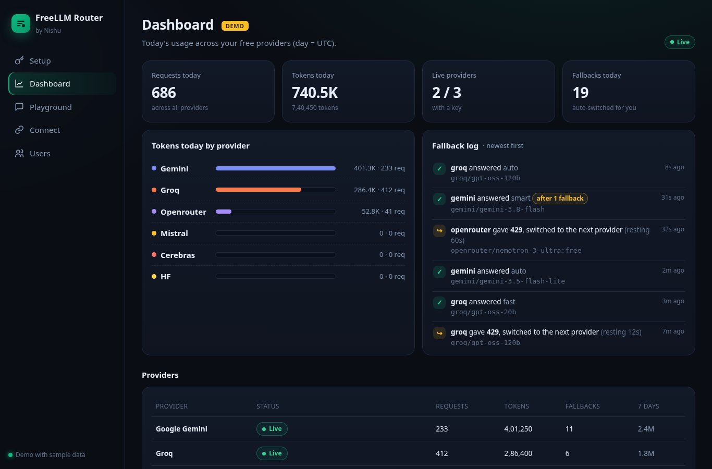
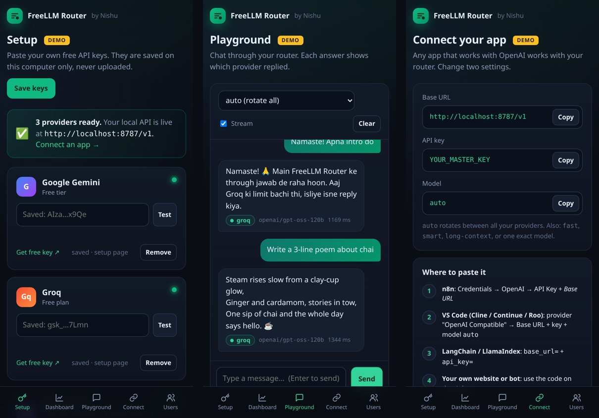

# FreeLLM Router 🔀

**Your own free AI API on your own computer.** Paste your free keys from Gemini, Groq, OpenRouter and Mistral into a simple web page. You get one OpenAI-compatible API at `http://localhost:8787/v1` that works with any app. When one provider hits its free limit, the next one answers automatically.


> **Honest note:** this is **not** "unlimited free AI". Every provider has a daily limit. FreeLLM Router **adds up** the free limits of the keys **you** add and switches between them for you. Every user runs it on their own machine with their own free keys.

🎮 **Live UI demo (sample data):** https://freellm-router-demo.sites.tab.bot · 👉 **Hinglish guide:** [neeche](#-hinglish-quickstart)




---

## 🚀 Quickstart: 4 steps, on your own computer

**1. Download.** On GitHub click **Code → Download ZIP** and unzip it, or:
```bash
git clone https://github.com/shanir01/FreeLLM-Router.git
```

**2. Start it with one command.**
- **Windows:** double-click **`start.bat`**. (If Node.js is missing, it tries to install it with winget. If that fails, it opens nodejs.org for you.)
- **Android (Termux):**
  ```bash
  pkg install git -y && git clone https://github.com/shanir01/FreeLLM-Router.git
  cd FreeLLM-Router && sh start.sh
  ```
  (`start.sh` installs Node.js itself when it's missing. It also runs on Linux and Mac.)

**3. Paste your free keys.** Your browser opens **http://localhost:8787** on the **Setup** page. Click **Get free key** on a provider, paste the key, press **Test**, then **Save keys**. One key is enough to start; more keys give you more free requests.

| Provider | Get the key |
|---|---|
| Google Gemini | https://aistudio.google.com/apikey |
| Groq | https://console.groq.com/keys |
| OpenRouter (free models) | https://openrouter.ai/keys |
| Mistral (free mode) | https://console.mistral.ai/api-keys |
| Cerebras (trial only) | https://cloud.cerebras.ai |

Keys are saved only on your computer, in `keys.local.json` (that file is git-ignored). A `.env` file also works if you prefer.

**4. Use it.** Open **Connect** in the app to copy the settings, or paste these into any OpenAI-compatible app:

| Setting | Value |
|---|---|
| Base URL | `http://localhost:8787/v1` |
| API key | anything, e.g. `local` (or your `MASTER_KEY` if you set one) |
| Model | `auto` |

```python
from openai import OpenAI   # pip install openai
client = OpenAI(base_url="http://localhost:8787/v1", api_key="local")
r = client.chat.completions.create(model="auto", messages=[{"role": "user", "content": "Namaste!"}])
print(r.choices[0].message.content)
```
The **Dashboard** shows tokens and requests for each provider today, which providers are live, and a fallback log. The **Playground** lets you chat in the browser and shows which provider answered each message.

> Manual start (any OS): `npm start` or `node src/server.js`. No `npm install` is needed; there are no dependencies.

---

## ✨ Features

| | |
|---|---|
| 🧩 **Setup page** | Paste keys in the browser, test them against the real provider, save them locally. No file editing. |
| 🔌 **OpenAI-compatible** | `POST /v1/chat/completions` (normal + streaming), `GET /v1/models`. Works with the OpenAI SDKs, n8n, LangChain, Cline/Continue, and anything that lets you change the base URL. |
| 🔁 **Auto-fallback** | 429, quota, 5xx, timeout or out-of-credits on one provider → the same request goes to the next one. |
| 🔄 **Round-robin** | `auto` rotates the first provider on every request, so your free limits are used evenly. |
| 📊 **Dashboard** | Usage per provider (requests, tokens, today and 7 days), live status, fallback log. |
| 💬 **Playground** | Chat in the browser; every answer shows its provider, model and speed. |
| 🔗 **Connect page** | Base URL, key and copy-paste code for Python, Node and curl. |
| 🪶 **Zero dependencies** | Pure Node.js 20+. One-click `start.bat` / `start.sh`. |
| 🛡️ **Safe by default** | Listens on localhost only. Only `free: true` models are called. Keys are hidden from logs. |
| 👥 **Server mode (advanced, off by default)** | Host it for other people: an admin panel creates `sk-flr-…` keys with daily token limits, plus an optional signup page. [See below](#-server-mode-advanced). |

## 🧠 How it works

```
your app / website / bot  ──►  http://localhost:8787/v1   (FreeLLM Router on YOUR computer)
                                   │ picks a provider that still has free limit left
                    ┌──────────────┼───────────────┬────────────────┐
                  Groq          Gemini          Mistral       OpenRouter :free   ← YOUR free keys
                    429? ────► next one, same request
```

## 📋 Free tiers (checked 2026-11-02)

Free tiers change often. The numbers below come from each provider's own docs on **2026-11-02**. ✅ = the number is on the provider's own page. ⚠️ = the provider only shows the number inside your account, so the router uses a safe guess and also learns from real 429 answers. Edit them any time in `router.config.json`.

| Provider | Free? | Models used by default | Free limits | Source |
|---|---|---|---|---|
| **Google Gemini** (AI Studio) | ✅ Free tier | `gemini-3.8-flash`, `gemini-3.5-flash-lite` | ⚠️ Per-model limits are only shown in AI Studio (router guesses 10–15 req/min). Daily quota resets at midnight Pacific time. **On the free tier Google may use your prompts to improve its products.** | [pricing](https://ai.google.dev/gemini-api/docs/pricing), [rate limits](https://ai.google.dev/gemini-api/docs/rate-limits) |
| **Groq** | ✅ Free plan | `openai/gpt-oss-120b`, `openai/gpt-oss-20b`, `qwen/qwen3.8-27b` | ✅ Per model: 30 req/min, 1,000 req/day, 8K tokens/min, 200K tokens/day | [rate limits](https://console.groq.com/docs/rate-limits) |
| **OpenRouter** (`:free` models) | ✅ Free models | `google/gemma-4-31b-it:free`, `nvidia/nemotron-3-ultra-550b-a55b:free` | ✅ For the whole account, across all `:free` models: 20 req/min and **50 req/day** (1,000/day once you have bought at least $10 of credits in total) | [limits](https://openrouter.ai/docs/api-reference/limits) |
| **Mistral** | ✅ Free mode | `mistral-small-latest` | ⚠️ Included monthly usage. The limits are shown on your account's Limits page (router guesses 50 req/min) | [usage & limits](https://docs.mistral.ai/admin/billing-usage/usage-limits) |
| **Cerebras** | ⚠️ **Trial only** | `gpt-oss-120b` | ✅ $5 of credits that expire after 30 days (a payment method is required). Trial: 5 req/min, 30K tokens/min, 1M tokens/day. **No permanent free tier.** | [rate limits / FAQ](https://inference-docs.cerebras.ai/support/rate-limits) |
| **Hugging Face** | ❌ Not for free accounts | `openai/gpt-oss-120b` (off by default) | Free accounts get **no** monthly inference credits. PRO gets $2/month. Set `"free": true` on it in `router.config.json` only if you have credits. | [pricing](https://huggingface.co/docs/inference-providers/pricing) |

Rough idea: Groq alone gives up to about 3,000 requests/day across its 3 models (each model has its own 1,000/day). The others add their own limits on top. Real numbers depend on your account.

## 🧪 Test it without any keys

```bash
npm run demo     # the real router against 2 local fake providers: the first answers 429, the second answers
npm test         # 49 automated tests (fallback, round-robin, setup page, quotas, streaming, ...)
```
With no keys at all, chat requests answer a clear `503 no_api_keys` that tells you to open the Setup page.

## 🧩 Models you can ask for

`GET /v1/models` lists them. The `model` field in a request can be:

| model | What happens |
|---|---|
| `auto` (default) | **Round-robin** across all providers, with fallback |
| `fast` | Small, fast models first (Groq 20B, Gemini Flash-Lite, …) |
| `smart` | Bigger models first (Gemini 3.8 Flash, GPT-OSS 120B, Nemotron Ultra, …) |
| `long-context` | Gemini first (1M-token context) |
| `groq/gpt-oss-120b`, `gemini/gemini-3.8-flash`, … | One exact model, no fallback |

Change the order, add models or add any other OpenAI-compatible provider in `router.config.json` (`"strategy"`, `"alias_strategy"`, `"aliases"`, `"models"`).

## 👥 Server mode (advanced)

Off by default. Use it only if you want to **host** the router and let other people use **your** free limits with their own keys. Turn it on with `SERVER_MODE=true` in `.env` (and set `MASTER_KEY` + `ADMIN_PASSWORD`). The **Users** page then appears in the app.

### Multi-user keys

1. Open the app (`http://your-server/`) and log in with `ADMIN_PASSWORD`.
2. **Users → Create key**: enter a name and a daily token quota (default `DEFAULT_USER_QUOTA`, 50,000). Copy the `sk-flr-...` key (it's shown **once**) and send it to that person.
3. They use it exactly like OpenAI:
   ```python
   client = OpenAI(base_url="https://your-server/v1", api_key="sk-flr-...")
   ```
4. From the dashboard you can change a quota, turn a key off, make a new key, or delete a user. Each user sees their own usage at `GET /v1/me`.
5. When a user's tokens for today run out, they get:
   ```json
   HTTP 429  {"error":{"code":"daily_quota_exceeded","message":"daily quota over: you used 50000 of 50000 tokens today. It resets at 00:00 UTC ..."}}
   ```

**Public signup (optional):** set `ENABLE_SIGNUP=true` (server mode only). Then anyone can open `https://your-server/signup` and get a key with the default quota. It allows 2 keys per IP per day and `MAX_USERS` in total. It's off by default. Remember: all users share **your** free provider limits.

Notes: the quota is checked before each request, so the last request of the day can go a little over. Tokens are counted from the provider's `usage` numbers. If a provider sends none (some streams), the router estimates about 4 characters per token. Your own `MASTER_KEY` has no quota.

### Host it free on Render (server mode)

[](https://render.com/deploy?repo=https://github.com/shanir01/FreeLLM-Router)

1. Click the button and log in to Render with GitHub. It reads `render.yaml` and creates a **free** web service with `SERVER_MODE=true`.
2. Fill in your provider keys and `ADMIN_PASSWORD`. `MASTER_KEY` is generated for you; find it under **Environment**.
3. After the deploy you get `https://freellm-router-xxxx.onrender.com`. Your API is at `https://…onrender.com/v1` and the dashboard at `https://…onrender.com/`.

**Honest limits of Render free** ([docs](https://render.com/docs/free)):
- It **sleeps after 15 minutes without traffic**. The next request wakes it in about 1 minute.
- Its disk is temporary: **local files are lost every time it sleeps, restarts or redeploys.** That means user keys and usage counters too, unless you turn on **Cloud save**:
  1. Create a **secret** gist at https://gist.github.com (any file, e.g. `readme.txt`) and copy its ID from the URL.
  2. Create a token at https://github.com/settings/tokens (classic, tick only **gist**).
  3. Add `GIST_ID` and `GITHUB_TOKEN` in Render → Environment. The router downloads `users.json` and `router.state.json` from the gist at startup and uploads changes every 60 s. (Up to about a minute of usage counting can be lost.)
- 750 free instance hours per month per workspace.

You can also use the **Download backup / Restore backup** buttons in the dashboard.

**Other hosts:** anything that runs a Node 20 server or a Docker container works (`Dockerfile` included; mount a volume on `/data`). **Vercel / Cloudflare Workers are not a good fit**, because the router is a long-running server that keeps counters and users in files.

**Other devices on your Wi-Fi:** start with `HOST=0.0.0.0` (needs `MASTER_KEY`) and use `http://<your-local-IP>:8787/v1`.

## 📡 API reference

| Method & path | Auth | What |
|---|---|---|
| `POST /v1/chat/completions` | master key or user key | OpenAI chat completions (set `"stream": true` for streaming) |
| `GET /v1/models` | master key or user key | aliases + models (`available` = key present) |
| `GET /v1/me` | user key (server mode) | your quota and usage today |
| `GET /` | public page | the app: Setup, Dashboard, Playground, Connect (asks for the admin password only when one is set) |
| `GET/POST /admin/api/keys`, `POST /admin/api/keys/test` | admin (on localhost with no password: this computer only) | read / save / test provider keys from the Setup page |
| `GET /signup`, `POST /signup` | public, only if `SERVER_MODE=true` and `ENABLE_SIGNUP=true` | get a user key |
| `GET /admin/api/stats` | admin | provider status, usage, models |
| `GET/POST /admin/api/users`, `PATCH/DELETE /admin/api/users/:id`, `POST /admin/api/users/:id/regenerate` | admin | manage users |
| `GET /admin/api/export`, `POST /admin/api/import` | admin | backup / restore users |
| `GET /healthz` | public | health check |

Auth header: `Authorization: Bearer <key>` (or `x-api-key: <key>`). Admin: the same header with `ADMIN_PASSWORD`, or `x-admin-password`.

Response headers: `x-router-provider`, `x-router-model`, and `x-quota-remaining` (for user keys).

## ⚙️ Settings (`.env`, all optional)

| Variable | Meaning |
|---|---|
| `MASTER_KEY` | Your own API key (no quota). Optional on localhost; **required** when the server is reachable from outside. |
| `ADMIN_PASSWORD` | Dashboard password (falls back to `MASTER_KEY`). |
| `GEMINI_API_KEY`, `GROQ_API_KEY`, `OPENROUTER_API_KEY`, `MISTRAL_API_KEY`, `CEREBRAS_API_KEY`, `HF_TOKEN` | Provider keys. Any subset. |
| `SERVER_MODE` | `true` turns on user keys, the Users page and signup (default `false`). |
| `DEFAULT_USER_QUOTA` | Daily tokens for new user keys (default 50000). |
| `ENABLE_SIGNUP` | `true` turns on the public `/signup` page (default `false`). |
| `MAX_USERS` | Max user keys (default 200). |
| `GIST_ID`, `GITHUB_TOKEN`, `SYNC_SECONDS` | Cloud save to a private gist (optional). |
| `PORT`, `HOST`, `STATE_FILE`, `USERS_FILE`, `KEYS_FILE`, `CONFIG_FILE` | Server options. On Render `PORT` is set for you. |

## 🔒 Security notes

- Never upload `.env` (it's in `.gitignore`). Never put your `MASTER_KEY` in website code that runs in the browser, because anyone can read it there. Give each app or person its own user key instead.
- By default it listens on `127.0.0.1` (this computer only). It refuses to listen publicly without a `MASTER_KEY`.
- Keys pasted on the Setup page are stored in `keys.local.json` on your machine (git-ignored), and the dashboard only ever shows the first and last 4 characters.
- User keys are saved only as SHA-256 hashes; provider keys never appear in logs or `/stats`.
- Read each provider's terms. Sharing your free quota with many people may be against some providers' terms; you are responsible for how your router is used.

## 🙌 Credits

Based on **[free-llm-router](https://github.com/waseemnasir2k26/free-llm-router)** by **Waseem Nasir** (MIT License), which provides the routing engine: token buckets, Retry-After handling, cooldowns, removed-model detection, the free-only guard, streaming passthrough, key redaction and the test suite.

**FreeLLM Router changes (by Nirbhay Sharma):** the web app (Setup page with key testing, Dashboard, Playground, Connect page), one-click `start.bat`/`start.sh`, `.env` loading, `MASTER_KEY`, multi-user API keys with daily token quotas, a signup page, round-robin, per-provider token/usage counters, shared provider-wide limits (OpenRouter), 402/out-of-credits fallback, Hugging Face, models updated to November 2026, Render one-click deploy, gist cloud save, CORS, `/v1/me`, a Hinglish guide and more tests.

## 📄 License

MIT. See [LICENSE](LICENSE) (it keeps the original author's copyright notice).

---

## 🇮🇳 Hinglish Quickstart

**Ye kya hai?** Tumhare apne computer/phone pe chalne wala ek chhota app. Tum apni **free** API keys (Gemini, Groq, OpenRouter, Mistral) ek web page pe paste karte ho, aur tumhe ek API milti hai, `http://localhost:8787/v1`, bilkul OpenAI jaisi. Ek provider ki free limit khatam hui, to agla provider apne aap jawab dega.

**Sach baat:** "Unlimited free" kuch nahi hota. Har provider ki daily limit hai. Ye app tumhari saari free limits ko **jod** deta hai. Har user apne computer pe apni keys se chalata hai.

### 4 step me shuru karo

**1. Download karo:** GitHub pe **Code → Download ZIP** karke unzip karo (ya `git clone https://github.com/shanir01/FreeLLM-Router.git`).

**2. Chalao (ek command):**
- **Windows:** `start.bat` pe double-click karo. Node.js nahi hai to wo khud install karne ki koshish karega.
- **Android Termux:**
  ```bash
  pkg install git -y && git clone https://github.com/shanir01/FreeLLM-Router.git
  cd FreeLLM-Router && sh start.sh
  ```

**3. Keys paste karo:** Browser me **http://localhost:8787** khulega, seedha **Setup** page pe. Har provider ke card pe **Get free key** dabao, key copy karke paste karo, **Test** dabao (✓ aana chahiye), phir **Save keys**. Ek key se bhi kaam chalega, zyada keys = zyada free requests.

⚠️ Keys sirf tumhare computer pe save hoti hain (`keys.local.json`). Kisi ko mat bhejna, GitHub pe mat daalna.

**4. Use karo:** App me **Connect** page kholo, wahan sab copy karne ko ready hai:
- Base URL: `http://localhost:8787/v1`
- API key: kuch bhi, jaise `local`
- Model: `auto`

```python
from openai import OpenAI
client = OpenAI(base_url="http://localhost:8787/v1", api_key="local")
print(client.chat.completions.create(model="auto",
      messages=[{"role":"user","content":"Namaste"}]).choices[0].message.content)
```

**Dashboard** me dikhega har provider ne aaj kitne token/requests diye, kaun live hai, aur kab fallback hua. **Playground** me browser me hi chat karke test kar sakte ho; har jawab ke neeche likha hota hai kis provider ne diya.

### Server mode (advanced, by default band)
Agar tum ise online host karke **doosre logon** ko apni free limits use karne dena chahte ho:
1. `.env` me `SERVER_MODE=true`, `MASTER_KEY` aur `ADMIN_PASSWORD` daalo.
2. App me **Users** page aayega: naam + daily token limit daalo → **Create key** → `sk-flr-...` key user ko bhejo (ek hi baar dikhti hai).
3. Wo OpenAI ki tarah use karega: `base_url = tumhara-server/v1`, `api_key = unki key`.
4. Limit khatam → `429 daily quota over`, agle din 00:00 UTC (subah 5:30 IST) reset.
5. `ENABLE_SIGNUP=true` se `/signup` page khulta hai jahan log khud key le sakte hain.
6. Free hosting: README ka **Deploy to Render** button. Render free 15 min baad so jaata hai aur files mita deta hai, isliye **Cloud save** (`GIST_ID` + `GITHUB_TOKEN`) on karo.

Yaad rakho: server mode me saare users **tumhari** free limits share karte hain.

### Problem aaye to
- `503 no_api_keys` → Setup page pe abhi koi key save nahi hui.
- Test pe `401` → key galat hai ya copy karte waqt kat gayi.
- `503 all_providers_unavailable` → abhi saari free limits khatam ya cooldown pe. Thodi der baad try karo, ya aur keys add karo.
- Termux band karne pe server ruk jaata hai. `start.sh` wake-lock laga deta hai taaki Android use band na kare.

Made with ❤️ by **Nirbhay Sharma (NISHU)**. Based on [free-llm-router](https://github.com/waseemnasir2k26/free-llm-router) by Waseem Nasir (MIT).
